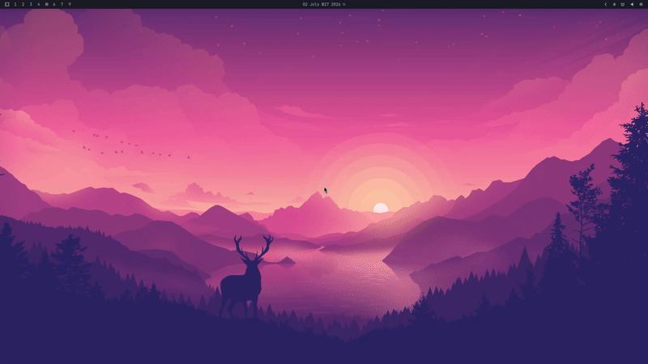
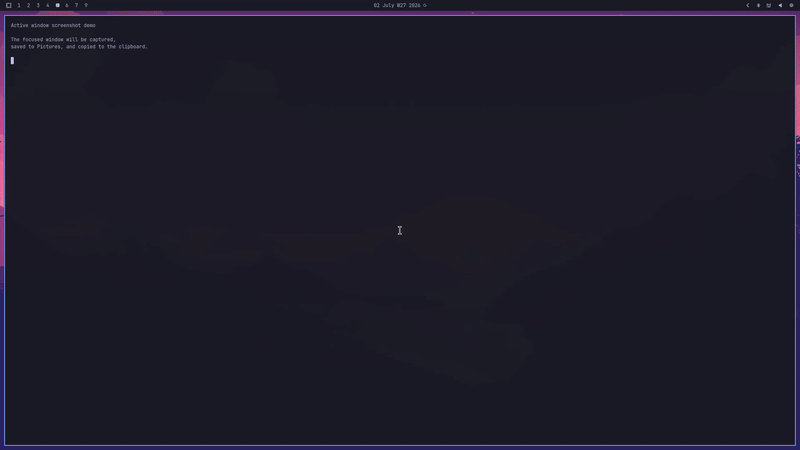

# Omarchy Scripts

Personal scripts and integrations for [Omarchy](https://omarchy.org/) and
[Hyprland](https://hypr.land/).

## Commands

| Title | Example | Description | Shortcut | Script | Dependencies |
| --- | --- | --- | --- | --- | --- |
| Active window screenshot | [](.github/assets/omarchy-capture-active-window.gif) | Captures the active Hyprland window, saves it to Pictures, copies it to the clipboard, and shows a native notification with the saved path and image preview, including during Do Not Disturb. | `Super + Shift + Print` | [omarchy-capture-active-window.sh](src/omarchy-capture-active-window.sh) | <ul><li><a href="https://wiki.hypr.land/Configuring/Using-hyprctl/">hyprctl</a></li><li><a href="https://jqlang.org/">jq</a></li><li><a href="https://man.archlinux.org/man/grim.1.en">grim</a></li><li><a href="https://man.archlinux.org/man/wl-copy.1.en">wl-copy</a></li><li><a href="https://omarchy.org/">Omarchy</a></li></ul> |
| Main + side stack layout | [](.github/assets/omarchy-layout-main-two-stack.gif) | Toggles the current workspace between `dwindle` and `master`, using the focused window as the main pane and stacking the other windows on the right. | `Super + Alt + L` | [omarchy-layout-main-two-stack.sh](src/omarchy-layout-main-two-stack.sh) | <ul><li><a href="https://wiki.hypr.land/Configuring/Using-hyprctl/">hyprctl</a></li><li><a href="https://jqlang.org/">jq</a></li><li><a href="https://man.archlinux.org/man/notify-send.1.en">notify-send</a></li></ul> |
| [Alacritty terminal hint](docs/alacritty.md) | - | Opens files, directories, and links with the desktop default applications through xdg-open. | `Ctrl + Shift + O` | [omarchy-open-terminal-hint.ts](src/omarchy-open-terminal-hint.ts) | <ul><li><a href="https://nodejs.org/en">Node.js ≥ 24</a></li><li><a href="https://alacritty.org/">Alacritty</a></li><li><a href="https://man.archlinux.org/man/xdg-open.1.en">xdg-open</a></li><li>perl-file-mimeinfo</li><li><a href="https://man.archlinux.org/man/notify-send.1.en">notify-send</a></li></ul> |
| [Alacritty code hint (beta)](docs/alacritty.md#copy-command-hints-beta) | - | Copies recognizable one-line Codex commands using native letter hints in the current terminal, including Herdr. | `Ctrl + Shift + Y` | [omarchy-copy-code-hint.ts](src/omarchy-copy-code-hint.ts) | Node.js ≥ 24, Alacritty, wl-copy |
| [Grammar](docs/grammar.md) | - | Corrects Portuguese text while preserving its voice, spacing and Markdown or HTML formatting. Uses the selection or clipboard and pastes the result into the original window. Requires [installation and API configuration](docs/grammar.md#installation). | `Super + Alt + G` | [omarchy-grammar.ts](src/omarchy-grammar.ts) | Node.js ≥ 24, wl-paste, wl-copy, wtype, hyprctl, Omarchy; Python 3 and PySide6 for HTML |

## Features

| Title | Example | Description | Shortcut | Script | Dependencies |
| --- | --- | --- | --- | --- | --- |
| [Codex notifications](docs/codex-notifications.md) | [](.github/assets/codex-notifications.png) | Shows Codex response, goal, interruption, failure, and interaction notifications with buttons that return to the session. | - | [omarchy-codex-notify.ts](src/omarchy-codex-notify.ts) | <ul><li><a href="https://nodejs.org/en">Node.js ≥ 24</a></li><li><a href="https://learn.chatgpt.com/docs/app-server">Codex daemon</a></li><li><a href="https://github.com/websockets/ws">ws</a></li><li><a href="https://omarchy.org/">Omarchy</a></li><li><a href="https://wiki.hypr.land/Configuring/Using-hyprctl/">hyprctl</a></li><li><a href="https://github.com/tmux/tmux/wiki">tmux</a> (when used)</li></ul> |
| [Scheduled Git push](docs/scheduled-git-push.md) | - | Pushes existing commits from a machine-local repository allowlist with work-branch safeguards. | - | [omarchy-git-auto-push.sh](src/omarchy-git-auto-push.sh) | <ul><li><a href="https://git-scm.com/">git</a></li><li><a href="https://man.archlinux.org/man/flock.1.en">flock</a></li></ul> |

## Installation

Clone the repository, enter the directory, and run the installer:

```bash
git clone git@github.com:MarlonPassos-git/omarchy-scripts.git ~/projects/omarchy-scripts
cd ~/projects/omarchy-scripts
./scripts/install.sh
```

The installer activates the command shortcuts and Alacritty terminal hints.
Codex notifications and scheduled Git pushes require the separate setup steps in their
documentation.

## Uninstall

```bash
cd ~/projects/omarchy-scripts
./scripts/uninstall.sh
```

The uninstaller removes project-managed keybindings and Alacritty symlinks.
Codex notifications and scheduled Git pushes remain installed.

## License

[MIT](LICENSE)
